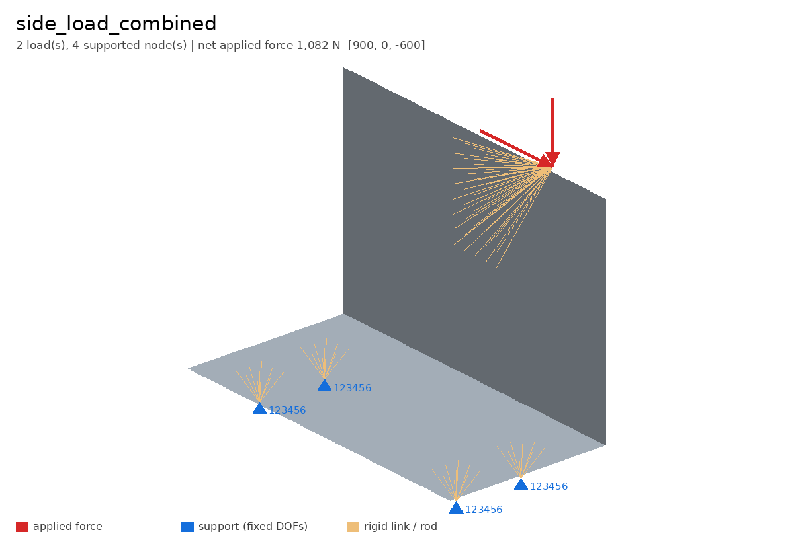
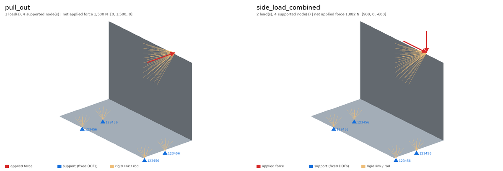

# fem-loadcase-viewer

See every load case in a Nastran / OptiStruct deck at a glance, without opening a
pre-processor.

`fem-loadcases model.fem` reads the bulk data and case control, then writes:

- one image per subcase with the shell mesh, **force arrows** (scaled to the largest
  load in the case), **supports** with their fixed DOFs, and RBE2 rigid spiders
- an atlas of all subcases for design reviews
- `summary.md` / `summary.json`: loads, supported nodes, **net applied force and moment**
  per subcase, plus warnings for anything suspicious (undefined nodes, non-basic
  coordinate systems)



## Why

When a model has many load cases, the quickest way to catch a wrong sign, a missing
load or a support on the wrong node is to *look* at each case and check that the net
force adds up. The tool grew out of documenting the composite-body FE model from my
work with the TUfast Moto Electric student team. On that deck (7 load cases, ~29k nodes,
~29k shell elements) it parses everything in under a second. The team model is not
published here; the images use a synthetic example.

## Use

```bash
pip install -e ".[test]"
fem-loadcases model.fem -o out              # images + summary
fem-loadcases model.fem -o out --up Y       # model with Y vertical
fem-loadcases model.fem --no-images         # report only
```

Try it on the included synthetic bracket:

```bash
python examples/make_bracket.py
fem-loadcases examples/bracket.fem -o out --yaw -50 --pitch 25
```

| Subcase | Label | Loads | Supported nodes | Net applied force (N) |
|---:|---|---:|---:|---|
| 1 | pull_out | 1 | 4 | (0, 1500, 0) |
| 2 | side_load_combined | 2 | 4 | (900, 0, -600) |



## What is supported

| Area | Cards / commands |
|---|---|
| Formats | small field (8), large field (`GRID*`), free field (commas), `+`/`*` continuations |
| Geometry | `GRID`, `CQUAD4`, `CTRIA3`, `CROD`, `RBE2` |
| Loads | `FORCE`, `MOMENT`, `LOAD` combinations (overall and per-set scale factors) |
| Constraints | `SPC`, `SPC1` (including `THRU`) |
| Case control | `SUBCASE`, `LABEL`, `ANALYSIS`, `LOAD =`, `SPC =` |
| Numbers | Nastran short exponents such as `-6.707-3` (= -6.707e-3) |

Other cards are counted in `summary.json` and otherwise ignored.

## Limits

- Coordinates and load directions are assumed to be in the basic system; a `GRID` with
  `CP ≠ 0` or a `FORCE` with `CID ≠ 0` is read as basic and reported as a warning.
- Pressure (`PLOAD*`), gravity (`GRAV`) and enforced displacements are not drawn yet.
- The viewer shows the **input** model; it does not read results (`.op2`, `.h3d`).

## Tests

```bash
pytest
```

The tests cover number parsing, all three field formats, continuations, load
combinations, `SPC1 … THRU`, resultant force and moment, and an end-to-end run on the
example deck.

MIT licence · Seung Wook Chae
